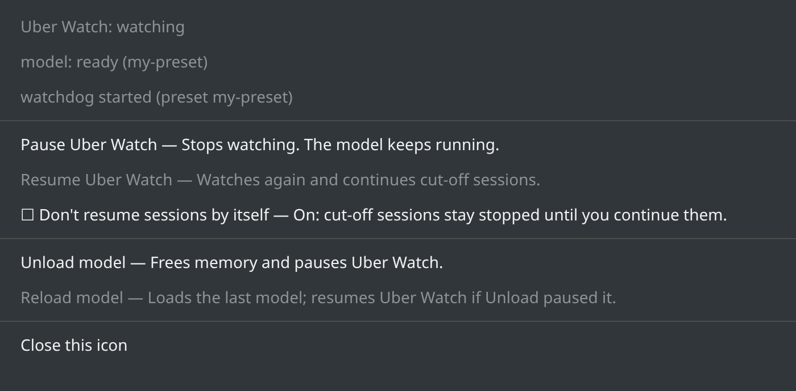

# Uber Watch (desktop)

Keeps your local model server up, with a tray icon to control it. Linux desktop version of Uber Watch.

> **Using a Steam Deck in game mode?** The same buttons are in the Decky Loader panel: [Uber Watch for game mode](https://github.com/ubermoc/Uber-Watch).



*The picture is a rendering of the real menu and its labels, not a screen capture.*

Built for the Strata local model server on Linux. Works with any setup where the model is started by `strata launch --preset <name>`.

## What it does

- **Watches the model.** Every 20 seconds it asks the server for its model list. After about a minute of failed checks, or right after a GPU reset, it stops the old process and loads the preset again. It gives up for 10 minutes after 5 restarts in an hour.
- **Continues what was cut off.** When the model is back, when the service starts (after a reboot or logout), and when a watched service comes back after a crash, it continues every agent session whose last turn was cut off. A session you stopped yourself with Esc is left alone, and so is one that was continued in the last 10 minutes.
- **Keeps your services up** (optional). List user services in `UBER_WATCH_UNITS` and it starts any that are stopped.

## The tray menu, in plain words

| Option | What it does |
|---|---|
| Pause Uber Watch | Stops watching, even after a reboot or a mode switch, until you resume. The model keeps running, but nothing restarts it if it fails. |
| Resume Uber Watch | Starts watching again: restarts the model if it fails and continues cut-off sessions. |
| Don't resume after a reboot | On: after a reboot or logout, sessions stay stopped until you continue them. |
| Don't resume cut-off sessions | On: after a model restart or a crash, cut-off sessions stay stopped. |
| Load model ▸ | Lists every model you can load. Pick one: the loaded model is stopped first (only one large model fits in memory), then the chosen one loads. The top of the menu shows the progress, or why it failed. |
| Sessions ▸ | One entry per project: its latest agent session, from any harness (Pi and Claude Code are built in; add others below). Sub-agent sessions are left out when the harness marks them (see below). Pick one: *Copy the command* puts e.g. `cd <folder> && pi --session <file>` on the clipboard to paste in a terminal, or *Open in a terminal* does it for you. |
| Unload model | Unloads the model to free memory **and pauses Uber Watch**, so it doesn't load the model again. |
| Reload model | Loads the last model again. If Unload paused Uber Watch, it **starts watching again**. |

## Switching models

The tray's **Load model** list (and `uber-watch-switch` on the command line) is the one-click place to change models:

```bash
uber-watch-switch list             # the models you can load; * marks the loaded one
uber-watch-switch switch <id>      # stop the loaded model, then load <id> (for example strata:inkling-sq20)
uber-watch-switch status           # what is loaded and the progress of a switch
uber-watch-switch stop             # unload (also pauses the watchdog, like the tray's Unload)
```

- **Where the list comes from (nothing is fixed in the code):** every Strata preset (`strata launch --list-presets`), plus your own entries in `~/.config/uber-watch/models.d/*.json` for models Strata does not start (for example a video model). Each model is listed under the name Strata itself gives it. A preset whose model files are missing is shown greyed out. To hide a preset, put its name on a line in `~/.config/uber-watch/hidden-models`.
- **Your own entry** (one file per model):
  ```json
  {"id": "video", "start": ["/path/to/start-script"], "stop": ["/path/to/stop-script"],
   "ready_url": "http://127.0.0.1:8188/", "ready_timeout": 600}
  ```
  `label` is optional: without it the list shows the name the model's own server reports once it has been loaded. `stop` is optional (without it the process started by `start` is ended); `ready_url` is optional (without it the model counts as loaded once `start` is running).
- **Order of a switch:** the watchdog is told to idle, the old model is stopped and the switch waits until its processes are gone (then ends them if they stay), the new one loads, and the watchdog is pointed at it, so a later restart loads the model you picked. If loading fails, nothing is loaded and Uber Watch is paused (as after Unload); **Reload model** or another pick starts again.
- A model started from `models.d` is not restarted by the watchdog; the watchdog only keeps Strata models up. It counts as a use for one stretch: after a reboot, or if it is no longer running when the watchdog starts, the watchdog goes back to the default model.
- **Agents:** switching away from a Strata model leaves running agent sessions without a model; they are not continued by themselves. The tray asks before it switches while agent sessions are running (the game mode panel shows a note). Which processes count: `~/.config/uber-watch/agent-processes`, one name per line (default `pi`). `uber-watch-switch agents` prints the count.
- **Unload** stops whatever is loaded, Strata or not.

## Sessions: one entry per project, no sub-agents

The tray's **Sessions** menu lists one entry per project folder (its newest session). A session reached through a sub-agent is not a project you were working on, so it must be left out. A harness can only be told apart from outside if it says so, so **if you see sub-agents in the list, your harness needs a one-line change.** Either of these is enough:

1. **A marker file in the sub-agent's folder.** Create an empty file named `.uber-watch-subagent` in the folder a sub-agent works in (for example `touch agents/researcher/.uber-watch-subagent`). Every session started in that folder is skipped. Do this in the script that sets your agents up, so it survives a reinstall. Use it when each sub-agent has a folder of its own.
2. **A field in the session file.** If sub-agents share the project's folder, have the harness write `"subagent": true` (or `"parentSession": "<id>"`) into one of the first 40 records of the sub-agent's session file. Claude Code already writes `"isSidechain": true` for its own sub-agents, so those are skipped without any change.

Without one of these, a sub-agent shows up like any other session. The tray cannot guess.

**Other harnesses:** Pi and Claude Code are built in. Add yours in `~/.config/uber-watch/sessions.json` (optional):

```json
{
  "harnesses": [
    {"name": "My harness", "glob": "~/.my-harness/sessions/*/*.jsonl", "command": "my-harness resume {id}", "cwd_key": "cwd"}
  ],
  "skip_folders_containing": ["/tmp/", "/scratch/"]
}
```

A session file is JSON lines with the project folder under `cwd_key` (default `cwd`) near the top. In `command`, `{cwd}`, `{file}` and `{id}` (the file name without `.jsonl`) are filled in. Add `"replace_defaults": true` to drop the built-in Pi and Claude Code entries.

## Install (no sudo)

```bash
git clone https://github.com/ubermoc/Uber-Watch-Desktop && cd Uber-Watch-Desktop && bash install.sh
mkdir -p ~/.config/systemd/user/strata-watchdog.service.d
cp settings.example.conf ~/.config/systemd/user/strata-watchdog.service.d/10-settings.conf
```

Edit `10-settings.conf` (preset, model name, address), then:

```bash
systemctl --user enable --now strata-watchdog
```

The tray icon needs `python-gobject` and `libayatana-appindicator`. It starts at your next login, or run `python3 ~/.local/share/uber-watch/uber-watch-tray.py &`.

## Files it uses

| File | Purpose |
|---|---|
| `~/.local/state/strata/watchdog.log` | what the watchdog did |
| `~/.local/state/strata/switch.json` | progress of the model switch: idle, stopping, loading, ready or failed (shared with the game mode panel) |
| `~/.local/state/strata/active-model` | the model the watchdog keeps up (written by a switch) |
| `~/.local/state/strata/switching` | exists while a switch runs: the watchdog idles |
| `~/.config/uber-watch/models.d/`, `hidden-models` | your own model entries, and presets to hide |
| `~/.local/state/strata/tray-state.json` | the last loaded preset (shared with the game mode panel) |
| `~/.local/state/strata/paused` | exists = paused: the watchdog idles and loads nothing, across reboots and mode switches (shared by the tray and the panel) |
| `~/.local/state/strata/no-resume` | exists = do not continue cut-off sessions after a model restart or a crash |
| `~/.local/state/strata/no-resume-reboot` | exists = do not continue sessions after a reboot, a logout or a restart of the watchdog |

## More from Ubermoc

[Ubermoc UI](https://github.com/ubermoc/Ubermoc-UI) · [Ubermoc Forever](https://github.com/ubermoc/Ubermoc-Forever) · [Ubermoc Speech](https://github.com/ubermoc/Ubermoc-Speech) · [Ubermoc Warcraft Mod Updater](https://github.com/ubermoc/Ubermoc-Warcraft-Mod-Updater)

## License

See `LICENSE`.
